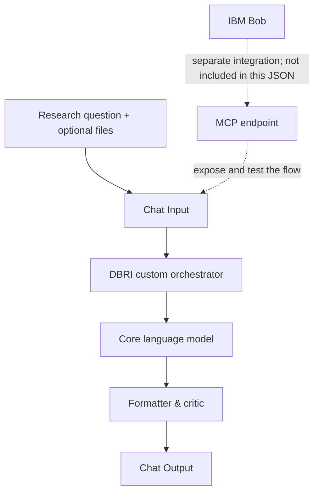

# DBRI — DataBrain Research Intelligence

**An AI research workflow for technology intelligence, structured analysis, and decision support.**

DBRI (DataBrain Research Intelligence) is a visual AI workflow project built with Langflow, designed to transform research questions and supplied context into structured, evidence-conscious research briefs. The project emphasizes traceable reasoning, explicit limitations, and clearly communicated findings to support more informed technology research and analysis.

Developed as a modular prototype, DBRI provides a foundation for experimenting with AI-assisted research orchestration, context processing, and consistent report generation. Its architecture is intended to evolve through validated integrations and reproducible evaluation.

Explore the workflow, implementation notes, and official development resources below to understand the current capabilities, configure the project, and evaluate its potential for further development.

[](https://www.langflow.org/)
[](./flows/README.md)
[](./flows/DataBrain%20Update%20Version%202.2%20-%20Task%2011%20IntegrationDeployment.json)
[](https://bob.ibm.com/download)
[](https://skillsbuild.org/)

DBRI is a local-first visual AI workflow project built with Langflow. Its direction is to help users frame a research question, work with supplied context, synthesize findings, and produce a consistent research brief with limitations made explicit.

> **Prototype notice:** the committed flow is a starting point for local evaluation, not a claim that every planned capability has been tested. Live web research, Composio tools, and IBM Bob/MCP integration must be configured and validated separately.

## Official Tools & Learning Resources

* **[IBM Bob — Download](https://bob.ibm.com/download):** Official download page for IBM Bob, an AI-powered software development partner.
* **[IBM SkillsBuild](https://skillsbuild.org/):** Official learning platform for AI, cybersecurity, data, and technology skills.

These links provide access to the official IBM tools and learning resources relevant to the project's development workflow.

## Contents

- [Overview](#overview)
- [Current workflow](#current-workflow)
- [Quick start](#quick-start)
- [Configuration and secrets](#configuration-and-secrets)
- [Example output](#example-output)
- [Repository map](#repository-map)
- [Project status](#project-status)
- [Limitations and roadmap](docs/limitations-and-roadmap.md)
- [Contributing](CONTRIBUTING.md)

## Overview

Research workflows often involve scattered documents, inconsistent summaries, and conclusions that are difficult to trace back to their evidence. DBRI explores a structured workflow for turning a research question and supplied context into a readable brief.

### Project goals

- Structure research around a clear question and scope.
- Use supplied files and context as inputs to the workflow.
- Separate findings, interpretation, risks, and recommendations.
- Make uncertainty and evidence gaps visible instead of inventing citations or statistics.
- Keep the workflow inspectable and reproducible in a local Langflow environment.

### Current workflow components

The exported flow contains five nodes connected in one main path:

| Component | Role in the current flow |
| --- | --- |
| Chat Input — User Command + File | Receives the user's request and optional supported files. |
| Custom orchestrator — DataBrain V20 Local RAG File Orchestrator | Prepares the agent prompt and handles the flow's custom context/file logic. |
| DataBrain V20 Core LLM | Model component with Google Generative AI provider options in the export. |
| Recovery Formatter & Critic | Formats the model response and provides a critique/recovery stage. |
| DataBrain Final Answer | Returns the final message to the Langflow chat interface. |

See [Architecture](docs/architecture.md) for the current path and the separate planned integration boundary.

## Current workflow



The **solid path** represents the flow described by the JSON. The **dashed path** is an integration direction from the hackathon architecture; it is not evidence that an MCP server or IBM Bob connection is already configured.

## Quick start

1. Install or open **Langflow 1.12.4** in your local Windows environment.
2. Download [](./flows/DataBrain%20Update%20Version%202.2%20-%20Task%2011%20IntegrationDeployment.json)
3. Import the JSON as a flow in Langflow. Review the nodes and component configuration after import.
4. Configure your Google Generative AI credential using the method supported by your installed Langflow component.
5. Run a small, low-risk prompt first, such as: “Create a research brief outline for evaluating AI customer-support assistants for Indonesian small businesses. Clearly label assumptions and missing evidence.”
6. Check the result for source traceability, factual accuracy, and unsupported claims before using it.

Detailed steps are in [Getting started](docs/getting-started.md).

## Configuration and secrets

- The JSON export does not need to contain your API key. Store credentials in Langflow's supported credential/global-variable mechanism and bind them in the component configuration.
- If you use the global-variable approach, `GOOGLE_API_KEY` is the intended variable name for the Google model credential; confirm that the model component is bound to it after import.
- `COMPOSIO_API_KEY` is **not proof of an active Composio integration**. The committed flow does not contain a Composio tool node in its active path.
- Never commit API keys, access tokens, cookies, private research, or a populated `.env` file.

Read [Configuration and security](docs/configuration.md) before connecting additional services.

## Example output

See [the sample research brief](examples/sample-research-brief.md). It demonstrates the report structure only: it is explicitly marked as illustrative and is **not** a captured result from a live DBRI execution.

A recommended report structure is:

1. Executive summary
2. Research question and scope
3. Key findings with evidence
4. Technology and market signals
5. Opportunities and risks
6. Sources and evidence quality
7. Limitations and confidence
8. Actionable recommendations

## Repository map

```text
.
├── README.md
├── CONTRIBUTING.md
├── .gitignore
├── flows/
│   ├── README.md
│   └── dbri-langflow-1.12.4.json
├── docs/
│   ├── README.md
│   ├── architecture.md
│   ├── getting-started.md
│   ├── configuration.md
│   ├── output-contract.md
│   └── limitations-and-roadmap.md
└── examples/
    └── sample-research-brief.md
```

## Project status

**Current maturity: prototype / local evaluation.**

Verified from the repository artifact:
- The flow file parses as JSON.
- The exported metadata identifies Langflow 1.12.4.
- The current graph contains five nodes and four edges.
- The model component includes Google Generative AI provider options.

Not yet established by the artifact alone:
- Successful import and execution on a clean local installation.
- Quality and source-grounding of live research outputs.
- A working Composio toolset connection.
- An exposed MCP endpoint and successful IBM Bob tool discovery/call.
- Production readiness, latency, or reliability under repeated tests.

See [Limitations and roadmap](docs/limitations-and-roadmap.md) for the validation checklist.

## License

No license file is currently included. Until a license is added, public visibility should not be interpreted as permission to reuse or redistribute the project.
