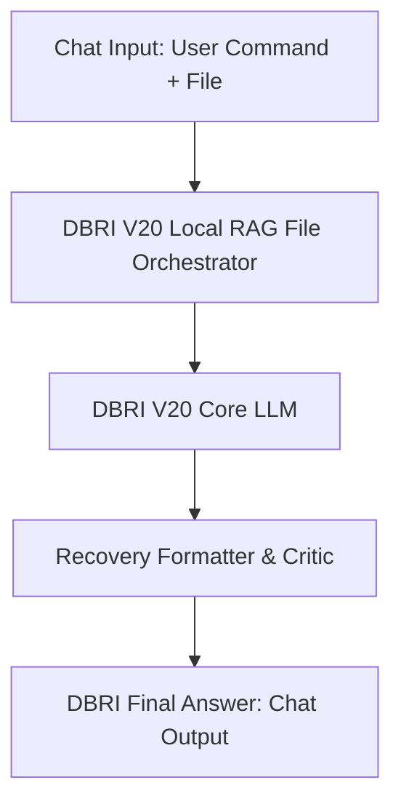
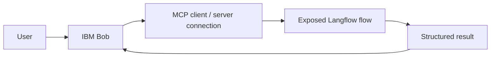

# Architecture

## Design intent

DBRI is intended to turn a user research question and optional supporting files into a structured research brief. Its design direction emphasizes evidence-aware synthesis: factual statements should be distinguishable from interpretation, forecast, and uncertainty.

## Existing Langflow graph

The committed export contains five nodes and four edges:

| Node | Current responsibility |
| --- | --- |
| Chat Input | Accepts the request and optional supported attachments. |
| Custom orchestrator | Builds the prompt and contains custom file/context/retrieval logic. Actual retrieval quality and external-source behavior still require test cases. |
| Core LLM | Holds provider options for Google Generative AI in the exported configuration. The credential must be configured locally. |
| Formatter & critic | Shapes the model response and applies a formatting/critique stage. |
| Chat Output | Returns the final message. |

## IBM Bob and MCP boundary

The hackathon reference architecture describes a separate chain:

This is an **integration plan, not part of the current JSON graph**. Follow the layered sequence: test the flow directly in Langflow; expose the intended flow through the locally available MCP mechanism; confirm that the tool can be discovered; then call it from IBM Bob. Debug one boundary at a time.

## Architecture principles

- Keep the initial workflow inspectable and small.
- Treat custom components as code: review dependencies, inputs, file access, network behavior, and error handling.
- Never state that an external search/tool ran unless it actually ran and returned evidence.
- Keep secrets outside the exported flow and source control.
- Add tool integrations only after the base flow has a repeatable passing smoke test.
